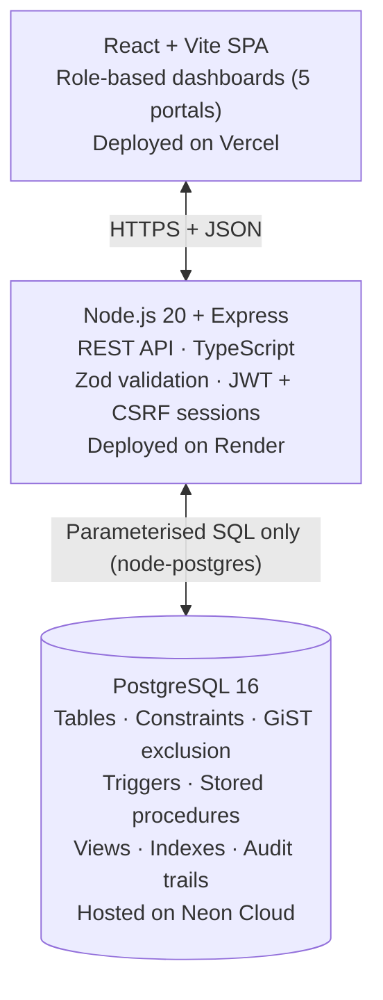

# CATMS — Clinic Appointment and Treatment Management System

> **CS3048 Database Management Systems** — MedSync Clinics, Sri Lanka  
> **Submission Repository:** [github.com/Vishwa-Srinath/CATMS](https://github.com/Vishwa-Srinath/CATMS)

> **Evaluation notice:** This code is submitted through a public GitHub repository. **No commits should be made after evaluation.** Each team member's individual contribution is documented in the [Team Contributions](#team-contributions) section below.

---

## Table of Contents

1. [Project Overview](#project-overview)
2. [Live Deployment](#live-deployment)
3. [System Architecture](#system-architecture)
4. [Technology Stack](#technology-stack)
5. [Database Design](#database-design)
6. [Core Database Rules & Integrity](#core-database-rules--integrity)
7. [API Modules](#api-modules)
8. [Management Reports](#management-reports)
9. [Team Contributions](#team-contributions)
10. [Migration Ownership](#migration-ownership)
11. [Getting Started (Local)](#getting-started-local)
12. [Running Tests](#running-tests)
13. [Project Documents](#project-documents)
14. [Repository Structure](#repository-structure)

---

## Project Overview

CATMS is a **database-centred, multi-branch clinic management system** built for **MedSync Clinics**, operating across Colombo, Kandy, and Galle, Sri Lanka. It replaces disconnected paper records and spreadsheets with a single authoritative source of truth for:

- appointment booking, rescheduling, and cancellation with doctor overlap protection
- clinical treatment recording and consultation notes
- automatic invoice generation with immutable price snapshots
- full and partial payments, overpayment protection, and insurance claims
- five management reports derived directly from live database views
- role-based access for Reception, Clinician, Branch Manager, Admin/Finance, and QA staff

The **database — not the UI — is the authority**. PostgreSQL constraints, triggers, stored procedures, and serialised transactions enforce every business rule, even when the application layer is bypassed.

### Operational Patient Journey

```
Authenticate Staff
  → Search / Register Patient (clinic-wide)
  → Book / Reschedule / Cancel / Walk-in Appointment
  → Complete Appointment
  → Record Consultation Note & Delivered Treatments
  → Generate Immutable Invoice Lines (price snapshot at time of treatment)
  → Submit / Resolve Insurance Claim
  → Accept Full / Partial Patient or Insurer Payment
  → View Outstanding Balances & Management Reports
```

---

## Live Deployment

| Component | URL |
| --- | --- |
| **Frontend** (React + Vite → Vercel) | https://frontend-eight-iota-ci93j9pn5n.vercel.app/ |
| **Backend** (Node.js + Express → Render) | https://catms-backend-uypw.onrender.com/ |
| **Database** (PostgreSQL 16 → Neon Cloud) | `ep-old-rain-b3zid4wa-pooler.c-4.ap-southeast-1.aws.neon.tech` |

### Demo Accounts

| Username | Role | Primary Use |
| --- | --- | --- |
| `admin.user` | Admin / Finance | Reports, staff management, invoicing, claims |
| `reception.user` | Receptionist | Patient registration, appointment booking |
| `s.silva` | Clinician / Doctor | Consultation notes, treatment recording |
| `k.perera` | Branch Manager | Branch-level operational view |

> All accounts use password: `CorrectPassword123!`

---

## System Architecture



### Key Design Decisions

- **No ORM.** Every query is written in explicit, parameterised SQL via `node-postgres`. The schema is the ground truth.
- **Database-level concurrency control.** A GiST exclusion constraint on `tstzrange` prevents double-booking at the storage engine level. Pessimistic row-level locking (`SELECT … FOR UPDATE`) serialises concurrent booking attempts.
- **Stored procedures** (`catms.book_appointment`, `reschedule_appointment`, `cancel_appointment`, `update_appointment_status`) encapsulate multi-step atomic operations.
- **Immutable audit trails.** `appointment_status_log` and `appointment_history` are append-only; every state transition is permanently recorded.
- **Price snapshots.** `appointment_treatment.unit_price_at_time` captures the catalogue price at the moment of treatment delivery so later price changes never alter historical invoices.
- **Database roles & grants.** `catms_api` (runtime), `catms_reception`, `catms_clinician`, `catms_manager`, and `catms_finance` are distinct PostgreSQL roles with minimal privileges enforced independently of the API layer.

---

## Technology Stack

| Layer | Technology | Purpose |
| --- | --- | --- |
| **Database** | PostgreSQL 16 (Neon Cloud) | Relational model, ACID transactions, constraints, triggers, stored procedures, views, indexes |
| **Database client** | `node-postgres` (`pg`) | Direct parameterised SQL — no ORM |
| **Backend** | Node.js 20 + Express + TypeScript | Thin REST API layer over database procedures and views |
| **Validation** | Zod | Runtime request schema validation |
| **Authentication** | `bcrypt` + JWT + CSRF tokens | Password hashing, role-aware sessions, CSRF protection |
| **Frontend** | React 18 + Vite + TypeScript | Role-based QA and demonstration interface |
| **UI** | Tailwind CSS, TanStack Query, React Router, Recharts | Design system, server-state, routing, report charts |
| **Testing** | Vitest, Supertest | Backend API integration tests and frontend unit tests |
| **CI** | GitHub Actions | Lint, build, migration smoke-test against live Neon DB |
| **Deployment** | Vercel (frontend), Render (backend), Neon (database) | Live cloud deployment |

---

## Database Design

### Schema Modules

The physical schema is divided into five ownership modules across **35 migrations**:

| Module | Area | Key Tables |
| --- | --- | --- |
| **Platform** | Extensions, schemas, roles, migration metadata | `catms.schema_migrations`, `catms_api` role |
| **Branch & Staff** | Branches, employees, doctors, specialties, user accounts | `branch`, `employee`, `doctor`, `specialty`, `doctor_specialty`, `user_account`, `staff_session` |
| **Patient & Insurance** | Patient identity, contacts, providers, policies, coverage | `patient`, `emergency_contact`, `insurance_provider`, `insurance_policy`, `policy_coverage` |
| **Appointment & Scheduling** | Booking, rescheduling, audit, doctor availability | `appointment`, `appointment_history`, `appointment_status_log`, `doctor_availability` |
| **Clinical & Billing** | Treatments, invoices, payments, claims, reports | `treatment_category`, `treatment_catalogue`, `appointment_treatment`, `invoice`, `invoice_line`, `payment`, `payment_reversal`, `insurance_claim` |

### Normalisation

All core tables satisfy **Boyce-Codd Normal Form (BCNF)**: every determinant is a candidate key, eliminating all update, insertion, and deletion anomalies.

The single deliberate BCNF exception is `appointment_treatment.unit_price_at_time` — a denormalised price snapshot intentionally preserved to ensure historical invoices are immutable even when catalogue prices change.

### Concurrency & Integrity Proof (CATMS-073)

The NFR suite subjected the scheduling engine to **10 simultaneous colliding writers** for the same doctor and 30-minute slot:

| Requirement | Target | Result |
| --- | --- | --- |
| Only 1 commit out of 10 writers | Exactly 1 | ✅ 1 commit, 9 rejections |
| Rejection type | `exclusion_violation` (23P01) | ✅ 100% exclusion constraint |
| Deadlocks | 0 | ✅ 0 deadlocks |
| Read latency P95 | < 200 ms | ✅ 116 ms |
| Write latency P95 | < 200 ms | ✅ 162 ms |

---

## Core Database Rules & Integrity

The following invariants are enforced by PostgreSQL, **not** application code:

1. A doctor cannot hold two overlapping, non-cancelled appointments — enforced by a **GiST exclusion constraint** on `tstzrange`.
2. Treatments and consultation notes may only be recorded for a `Completed` appointment — enforced by a **CHECK trigger**.
3. Invoice subtotals, covered amounts, and patient-payable amounts are maintained by **stored procedure billing logic** only.
4. A payment cannot cause total paid to exceed the patient-payable amount — **overpayment guard** in the payment procedure.
5. Rescheduling and status changes write to **immutable audit tables** (`appointment_status_log`, `appointment_history`).
6. A branch manager must be an active employee with the `Manager` role — enforced by a **stored procedure precondition check**.
7. Employee NICs, licence numbers, and usernames are **UNIQUE** with `btree` indexes.
8. Historical records use **soft deactivation** or appropriate `ON DELETE` cascade/restrict policies.
9. Concurrent booking attempts are serialised via `SELECT … FOR UPDATE` before the exclusion check commits.
10. All multi-step state changes fully commit or fully roll back — every mutation route is wrapped in `withTransaction()`.

---

## API Modules

| Module | Path prefix | Owner |
| --- | --- | --- |
| Authentication & Sessions | `/api/auth` | Dev 2 — Sayuru Pilapitiya |
| Branch & Staff Administration | `/api/staff` | Dev 2 — Sayuru Pilapitiya |
| Patients & Insurance | `/api/patients`, `/api/insurance` | Dev 3 — Nirmana Pansilu Liyanagamage |
| Claims | `/api/claims` | Dev 3 — Nirmana Pansilu Liyanagamage |
| Appointments & Scheduling | `/api/appointments` | Dev 1 — G.D.V.S. Gallage (Vishwa) |
| Clinical Care & Billing | `/api/clinical`, `/api/billing` | Dev 4 — VidathAnuja |
| Payments | `/api/payments` | Dev 4 — VidathAnuja |
| Reports & Data Import | `/api/reports`, `/api/import` | Dev 5 — Imain Willaddara |
| Shared Platform | Health, error handling, DB pool, transaction helper | Dev 1 — G.D.V.S. Gallage (Vishwa) |

---

## Management Reports

Five reports are produced from PostgreSQL views and parameterised functions:

| # | Report | Description |
| --- | --- | --- |
| R1 | Branch-wise Daily Appointment Summary | Totals of Scheduled, Completed, and Cancelled appointments per branch per day |
| R2 | Doctor-wise Revenue | Gross billed and actually collected revenue per doctor |
| R3 | Outstanding Patient Balances | Every unpaid or partially paid invoice and its remaining balance |
| R4 | Treatments by Category | Treatment counts and revenue by category for a selected date range |
| R5 | Insurance vs. Out-of-Pocket | Monthly comparison of insurance-covered and patient-paid amounts |

All five reports were validated against the CATMS-008 hand-calculated financial worked example with **zero variance**.

---

## Team Contributions

> This section fulfils the evaluation requirement: *"The GitHub README should clearly indicate each team member's contribution."*

---

### Dev 1 — G.D.V.S. Gallage (Vishwa) · `vishwasrinath4@gmail.com`
**Role: Team Lead · Platform & Scheduling Module Owner**

- **Repository & infrastructure:** set up the GitHub repository, branch protection, GitHub Actions CI pipeline (lint + build + Neon migration smoke-test), CODEOWNERS matrix, and Neon DB migration runner.
- **Database platform migrations (001–003, 060–089, 160–163):** PostgreSQL extensions (`btree_gist`, `pgcrypto`), schema/role definitions, migration metadata table with SHA-256 checksum tracking, appointment schema with 15-minute grid CHECK constraint, GiST exclusion constraint (`tstzrange && tstzrange`) preventing double-booking, `catms.book_appointment` stored procedure (7-step atomic validation), rescheduling and cancellation procedures, `appointment_status_log` and `appointment_history` append-only audit tables, `doctor_availability` exceptions table, and all database-level GRANT scripts.
- **Backend shared platform:** `withTransaction()` helper with automatic rollback on error, connection pool (`pool.ts`), shared error registry and HTTP error handler (`errors.ts`, `errorHandler.ts`), correlation IDs, health/readiness endpoints, API assembly, and the `appointments` module routes and service.
- **Frontend foundation:** `AppShell` layout with role-aware navigation, `DashboardPage`, shared API client, React Router integration, shared component library, `ClinicContext`, and the golden end-to-end browser journey test (CATMS-069).
- **Concurrency & NFR:** designed and executed the CATMS-073 10-writer scheduling concurrency NFR suite — zero deadlocks, sub-200 ms P95 write latency confirmed.
- **Integration lead:** coordinated Gate G0–G6 exit reviews, managed feature-freeze, Neon serverless resilience fix, and final demo rehearsal.

---

### Dev 2 — Sayuru Pilapitiya · `sayurupilapitiya@gmail.com`
**Role: Branch, Staff, Access & Security Module Owner**

- **Database migrations (020–024):** `branch`, `employee`, `doctor`, `specialty`, `doctor_specialty` tables with full referential integrity; staff assignment and branch-manager eligibility rules; manager/specialty integrity trigger; `GRANT`/`REVOKE` security policies for all scoped PostgreSQL roles.
- **Authentication system:** JWT `httpOnly` cookie sessions with `Secure` + `SameSite=Strict`, CSRF double-submit token validation, atomic failed-login counter with account lockout, and revocable session table (`staff_session`).
- **Backend auth & staff modules:** `/api/auth` (login, logout, `/me`) and `/api/staff` (branch CRUD, employee management, doctor assignment); Zod schemas and role-guard middleware.
- **Security audit (CATMS-074):** full RBAC audit verifying Receptionist, Clinician, and Manager roles are blocked from out-of-scope routes at both API and PostgreSQL level.
- **Frontend administration:** `AdministrationPage`, `LoginPage`, and all administration feature components.
- **Deployment:** configured `render.yaml` for Render backend, `vercel.json` SPA rewrite rule for Vercel frontend, and `.dockerignore`.

---

### Dev 3 — Nirmana Pansilu Liyanagamage · `nplg2004@gmail.com`
**Role: Patient, Insurance & Claims Module Owner**

- **Database migrations (040–043, 110–112, 160–161):** `patient`, `emergency_contact`, `insurance_provider`, `insurance_policy`, `policy_coverage` tables; patient registration stored procedure; policy coverage lifecycle procedures (active/suspended/expired transitions); `insurance_claim` and `claim_line` tables; claim submission and resolution stored procedures; patient insurance GRANT scripts.
- **Backend patients-insurance & claims modules:** `/api/patients` (register, clinic-wide search), `/api/insurance` (provider/policy/coverage CRUD), and `/api/claims` (submit, resolve, branch-scoped listings); enforced explicit `Asia/Colombo` timezone handling for all date boundaries.
- **Insurance scale & privacy NFR (CATMS-075):** claim allocation reconciliation at scale; privacy audit confirming no cross-branch patient data leakage.
- **Frontend patients & insurance:** `PatientsPage`, `FinancePage` (claims tab), patients-insurance feature components and UI tests; patient, insurance, and claim invariant protection tests.

---

### Dev 4 — VidathAnuja · `vidathbandara123@gmail.com`
**Role: Clinical Care, Invoicing & Payments Module Owner**

- **Database migrations (090–095, 130–131):** `treatment_category`, `treatment_catalogue` (LKR `DECIMAL(10,2)` pricing), `consultation_note` with revision history, `appointment_treatment` (price snapshot at delivery time), `invoice` and `invoice_line` (immutable after issuance), `payment` and `payment_reversal` tables; payment reversal idempotency migration.
- **Backend clinical-billing & payments modules:** `/api/clinical` (consultation notes, revision recording, treatment delivery gated on `Completed` status), `/api/billing` (invoice issuance and line generation), `/api/payments` (full/partial payments, reversal); overpayment guard and payer-specific cap enforcement.
- **Invoice immutability:** CATMS-034 — invoice lines lock after issuance; later catalogue price changes do not retroactively alter billed amounts.
- **Frontend clinical & billing:** `ClinicalPage`, `FinancePage` (billing/payment tab), clinical-billing feature components and payment balance refresh fix.
- **Ledger reconciliation (CATMS-076):** database-level ledger reconciliation test coverage ensuring payment totals always match invoice records.

---

### Dev 5 — Imain Willaddara · `imainwilladdara@gmail.com`
**Role: Reports, Data Ingestion & Test Quality Lead**

- **Database migrations (140–141):** five report views (`v_branch_daily_summary`, `v_doctor_revenue`, `v_outstanding_balances`, `v_treatments_by_category`, `v_insurance_vs_oop`) with branch and date filter parameterisation; supporting indexes for report query performance.
- **Backend reports-import module:** `/api/reports` (R1–R5 parameterised queries with authoritative SQL-level branch and date filters preventing client-side filter bypass), `/api/import` (RFC-4180 CSV parser for bulk patient data ingestion with audit logging to `audit_event`).
- **Report reconciliation:** validated all five reports against the CATMS-008 hand-calculated financial worked example — zero variance confirmed with every source module owner.
- **Frontend reports:** `ReportsPage` with R1–R5 Recharts visualisations; gated financial report tabs by staff role (Admin/Finance only — CATMS-064).
- **Data quality:** designed bulk and golden demonstration datasets; authored CSV ingestion test suite covering RFC-4180 parser edge cases.
- **Security fix (CATMS-072):** refactored `getBranchWiseSummary` from dynamic SQL to static parameterised SQL, eliminating a CodeQL injection alert.

---

## Migration Ownership

Migrations are numbered and applied in sort-version order by the migration runner (`sort -V`). Numbers are partitioned per developer to prevent merge conflicts:

| Range | Owner | Content |
| --- | --- | --- |
| `001–019` | Dev 1 — Vishwa | Extensions, schemas, base roles, migration metadata, platform functions |
| `020–039` | Dev 2 — Sayuru | Branch / staff / access tables, procedures, and security grants |
| `040–059` | Dev 3 — Nirmana | Patient / insurance-term tables and procedures |
| `060–089` | Dev 1 — Vishwa | Doctor availability, appointments, exclusion constraint, scheduling procedures, audit histories |
| `090–109` | Dev 4 — VidathAnuja | Treatment categories, catalogue, consultation notes, invoice, and payment tables |
| `110–129` | Dev 3 — Nirmana | Insurance claims, claim submission, and resolution procedures |
| `130–139` | Dev 4 — VidathAnuja | Payments, reversals, and idempotency |
| `140–159` | Dev 5 — Imain | Report views, indexes, and data-import support |
| `160–169` | Dev 1 — Vishwa | Cross-module FK fixes, patient/insurance grants, session security, scheduling grants |

> **Why gaps exist in the numbering:** each developer reserves a block of 20 numbers at the start of the project (see ADR-009). Only the migration numbers actually implemented appear in the repository; unused numbers within a block stay reserved for future patches within that module. This design prevents sequence-number merge conflicts across five developers working in parallel branches.

---

## Getting Started (Local)

### Prerequisites

- Node.js 20+
- PostgreSQL 16 (local instance) **or** a Neon cloud connection string
- `npm`

### Setup

```bash
# Clone the repository
git clone https://github.com/Vishwa-Srinath/CATMS.git
cd CATMS

# Backend
cd backend
cp .env.example .env          # fill DATABASE_URL and JWT_SECRET
npm install
npm run migrate               # applies all migrations in dependency order
npm run seed                  # loads deterministic demo data
npm run dev                   # starts API on http://localhost:3000

# Frontend (new terminal)
cd ../frontend
cp .env.example .env          # set VITE_API_URL=http://localhost:3000
npm install
npm run dev                   # starts React app on http://localhost:5173
```

### Local Checks

```bash
# Frontend
cd frontend && npm run lint && npm test && npm run build

# Backend
cd backend && npm run lint && npm test
```

---

## Running Tests

| Command | What it covers |
| --- | --- |
| `cd backend && npm test` | All backend integration tests — auth, staff, appointments, patients, claims, payments, reports, health |
| `cd frontend && npm test` | Frontend tests — appointments, patients/insurance, administration, clinical-billing, golden journey |
| `npm run test -- scheduling-concurrency-nfr` | 10-writer concurrency NFR suite (CATMS-073) |
| `npm run test -- insurance-scale-privacy-nfr` | Insurance scale and privacy NFR suite (CATMS-075) |

---

## Project Documents

| Document | Path |
| --- | --- |
| Software Requirements Specification v1.0 | [`docs/CATMS_SRS_new.pdf`](docs/CATMS_SRS_new.pdf) |
| Team Delivery Plan | [`docs/member_plan.md`](docs/member_plan.md) |
| Architecture Decision Records | [`docs/adr/`](docs/adr/) |
| Design System & UI/UX Specification | [`docs/CATMS_Design_System.md`](docs/CATMS_Design_System.md) |
| Database Explanation & Viva Guide (Dev 1) | [`docs/dev1_database_explanation.html`](docs/dev1_database_explanation.html) |
| Scheduling Concurrency NFR Report | [`docs/CATMS-073_Scheduling_Concurrency_and_Performance_NFR_Report.md`](docs/CATMS-073_Scheduling_Concurrency_and_Performance_NFR_Report.md) |
| Golden End-to-End Browser Journey | [`docs/CATMS-069_Golden_End_To_End_Browser_Journey.md`](docs/CATMS-069_Golden_End_To_End_Browser_Journey.md) |
| CODEOWNERS Matrix | [`.github/CODEOWNERS`](.github/CODEOWNERS) |

---

## Repository Structure

```
CATMS/
├── .github/
│   ├── CODEOWNERS              # Module ownership matrix
│   └── workflows/              # GitHub Actions CI
├── backend/
│   ├── src/
│   │   ├── app/                # Express app bootstrap       (Dev 1)
│   │   ├── db/                 # Pool, transaction helper    (Dev 1)
│   │   ├── shared/             # Error registry, middleware  (Dev 1)
│   │   └── modules/
│   │       ├── auth-staff/         # Auth & administration   (Dev 2)
│   │       ├── appointments/       # Scheduling              (Dev 1)
│   │       ├── patients-insurance/ # Patients & insurance    (Dev 3)
│   │       ├── claims/             # Insurance claims        (Dev 3)
│   │       ├── clinical-billing/   # Clinical & billing      (Dev 4)
│   │       ├── payments/           # Payments & reversals    (Dev 4)
│   │       └── reports-import/     # Reports & data import   (Dev 5)
│   └── tests/                  # Backend integration tests
├── database/
│   └── migrations/             # 35 numbered SQL migrations
├── frontend/
│   └── src/
│       ├── app/                # Router & shell              (Dev 1)
│       ├── api/                # API client                  (Dev 1)
│       ├── components/         # Shared UI components        (Dev 1)
│       ├── context/            # ClinicContext               (Dev 1)
│       ├── features/
│       │   ├── administration/     # Branch & staff UI       (Dev 2)
│       │   ├── appointments/       # Scheduling UI           (Dev 1)
│       │   ├── patients-insurance/ # Patient & claim UI      (Dev 3)
│       │   ├── clinical-billing/   # Clinical UI             (Dev 4)
│       │   └── reports/            # Reports UI              (Dev 5)
│       └── pages/              # Top-level page components
└── docs/                       # SRS, delivery plan, ADRs, guides
```

---

*Prepared as a **CS3048 Database Management Systems** course project for MedSync Clinics, Sri Lanka.*
